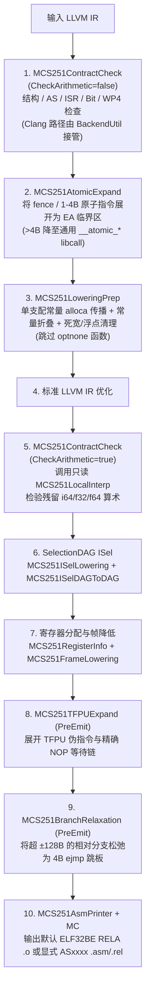

# 03. LLVM 后端流水线与代码生成

> **核对源码基线**：`cad7f0ab1f32`  
> **核心源码**：`llvm/lib/Target/MCS251/*`、`llvm/include/llvm/IR/IntrinsicsMCS251.td`、`llvm/lib/IR/Verifier.cpp`（`verifyMCS251ISR`）

---

## 1. 后端 Pass 流水线与契约检查

`MCS251TargetMachine`（`MCS251TargetMachine.cpp:251-379`）在传统 CodeGen 管线（`MCS251PassConfig`）与新 PassManager（`registerPassBuilderCallbacks`）中部署了一致的双阶段契约门禁：

### 1.1 `MCS251ContractCheck` 与 `MCS251LocalInterp`（WP4 错误纪律）
- **报错路径**：全部用户可触发的契约/能力拒收均经 `reportFatalUsageError` 报告（干净 exit 1，无崩溃堆栈转储）；在 Clang 内通过 `setContractCheckDeferred(true)` 交由 `DiagnosticsEngine` 接管。
- **结构阶段（优化前，防止优化隐藏非法实体）**：
  - 校验模块 `DataLayout` 与解析后的 `MemoryContract` 完全一致；
  - 双向核查 **ISR**（与 `llvm/lib/IR/Verifier.cpp:3175-3452` 一致）：`mcs251_intrcc (128)` ↔ `"mcs251-isr-vector"`、合法槽号 `0..126`、`void()` 非变参、`noinline`、`llvm.used`、零普通使用、同模块槽号唯一；
  - 双向核查 **Bit 对象**：AS0 `i8` 全局 + `"mcs251-bit-object"` + `align 1` + 无 COMDAT + 仅被 `llvm.mcs251.bit.obj.*` 消费；
  - **WP4 能力门禁（`verifyModuleCapabilities`）**：拒收 `indirectbr`/`blockaddress`、静态 `inttoptr` 指针初值（原子操作与多参数/变参间接调用均已支持）；ISR/Bit/G11 固定放置及显式 REL 输出仍拒收弱定义与 COMDAT；显式 REL 输出仍拒收有效调试信息（容忍 `LocTrackingOnly`）与模块/函数级内联汇编（默认 ELF 模式下普通弱定义/COMDAT、内联汇编与 DWARF `-g` 均已放行）；
  - 地址空间白名单 `{0,1,2,3,4,6,7,8,9}`（不含 AS5 与 `>=10`），校验 TFPU 调用签名须为精确 `i32(i32)` 或 `i32(i32,i32)`。
- **算术阶段（优化后、`PreISel` 前）**：
  - **`f64`**：在任何常量折叠/死代码豁免**之前无条件拒收**；
  - **`i64`**：纯 `zext`/`trunc`/`ptrtoint`/`inttoptr`/`bitcast` 往返放行；其余算术/比较/内建仅当只读解释器 `MCS251LocalInterp`（结合 `DominatorTree`）证明其为常量或死值时才放行，否则拒收；
  - **`f32`**：仅放行已接入的 16 个软浮点 libcall（加减乘除/取负/全比较/与任意 `<=32` 位有符号与无符号整数互转）；拒收 `frem`、浮点向量与全部 `llvm.*.f32` 数学内建（如 `llvm.sin.f32`/`llvm.sqrt.f32`/`llvm.fabs.f32`）。
- **`optnone` 兜底（`ReplaceNodeResults`）**：因为 `LoweringPrep` 严格跳过 `optnone` 函数，ISel 层通过 `getProvenSlotConstant`（支持 `SEXTLOAD` 感知，P12-5 已移除不安全的局部 DAG 回退）和 `allocaIsNeverRead` 处理残留的可证常量与不可观察宽值。

---

## 2. 算术、软浮点、TFPU、移位与跳转表

### 2.1 整数除/取模、软浮点、内存拷贝与原子库（32 个注册 Helper）
`MCS251HelperABI.h` 集中登记了全部 **32 个**后端可发射的运行时 libcall（供 Tag 28 自动补全函数签名；任何未注册的外部 libcall 会触发致命错误）：
- **8 个整数除/取模 Helper（SDCC 命名，ELF 符号带 `__` 前缀）**：
  - `i8` 的 `udiv`/`sdiv`/`urem`/`srem` 先 `Promote` 到 `i16`；`UDIVREM`/`SDIVREM` 保持 `Expand`（拆为两次独立调用）；
  - `i16`/`i32` 分别调用 `__divuint`、`__divulong`、`__divsint`、`__divslong`、`__moduint`、`__modulong`、`__modsint`、`__modslong`（源码见 `llvm/lib/Target/MCS251/Runtime/`）。
- **16 个 `f32` 软浮点 Helper（G7 S1'）**：
  - 算术 5 项：`__addsf3`、`__subsf3`、`__mulsf3`、`__divsf3`、`__negsf2`（`NEG_F32` 在 `LegalizeFloatTypes.cpp:548-551` 显式走 libcall 而非整型异或符号位）；
  - 比较 7 项：`__eqsf2`、`__nesf2`、`__ltsf2`、`__lesf2`、`__gtsf2`、`__gesf2`、`__unordsf2`；
  - 转换 4 项：`__floatsisf`、`__fixsfsi`、`__floatunsisf`、`__fixunssfsi`；窄整数（`i1`/`i8`/`i16`）与 `f32` 互转经 `i32` 提升完成（其中 `i1` `sitofp` 依赖 `SIGN_EXTEND_INREG` 的 `i1` Expand）。
- **3 个内存块 Helper（`RuntimeLibcalls.td` `MCS251SystemLibrary`）**：
  - `_memcpy`、`_memmove`、`_memset`（3 参栈 ABI）；`MaxStoresPerMemcpy/Memmove/Memset = 16`（`OptSize = 8`），小尺寸结构体拷贝直接内联展开，超大拷贝平滑降级为库调用。
- **5 个大对象原子 Helper（`validation/mcs251-runtime/src/mcs251_atomic.c`）**：
  - `___atomic_load`、`___atomic_store`、`___atomic_exchange`、`___atomic_compare_exchange`、`___atomic_is_lock_free`（通用 C11/GNU ABI，内部通过 `__builtin_mcs251_ea_save_disable`/`restore` 加锁保护）。

### 2.2 TFPU 硬件浮点协处理器代码生成（G7 S3）
源码：`IntrinsicsMCS251.td:82-128`、`MCS251ISelLowering.cpp:1665-1710`、`MCS251TFPUExpand.cpp`。

1. **IR 接口**：9 条带 `[IntrHasSideEffects]` 的内建（`llvm.mcs251.tfpu.{add,sub,mul,div,sqrt,sin,cos,tan,atan}`），参数与返回值均为 **`i32`（IEEE-754 位模式）**（避免通用软浮点合法化器无法软化 `f32` intrinsic 节点）。
2. **4 个 RA 前后伪指令与窗口隔离**：
   - `TFPU_LD_AR` / `TFPU_LD_BR`：先将操作数停泊在 `R0..R7` 窗口之外的 **`GPR32Win = {DR12}`**，避免提前写入协处理器寄存器窗口破坏外部测量窗口（如 demo 38 TPIN）；
   - `TFPU_<OP>`：显式 clobber `DR0, DR4, R0..R7, PSW`；
   - `TFPU_RD_AR`：将结果从 `DR4` 立即快照读回 **`GPR32Rd = {DR12, DR0}`**（故意排除 `DR4` 防止生成空操作 `mov dr4, dr4` 导致快照丢失；加入 `DR0` 防止嵌套调用时单寄存器死锁）。
3. **RA 后展开（`MCS251TFPUExpand`）**：在 `addPreEmitPass()` 中运行于分支松弛**之前**，将伪指令展开为 `mov dr4, <ar>` / `mov dr0,  ` → `TFPU_TRG`（`75 ED <cmd>`，向 SFR `DMAIR = 0xED` 写入立即命令码）→ **按手册最坏时钟数展开的直线型 `NOP` 链** → `mov <dst>, dr4`：

| 运算 | `ADD` | `SUB` | `MUL` | `DIV` | `SQRT` | `SIN` | `COS` | `TAN` | `ATAN` |
|---|---|---|---|---|---|---|---|---|---|
| `DMAIR` 命令码 | `0x1C` | `0x1D` | `0x1E` | `0x1F` | `0x20` | `0x2D` | `0x2E` | `0x2F` | `0x30` |
| 展开 `NOP` 数量 | **40** | **40** | **34** | **67** | **54** | **270** | **270** | **258** | **175** |

### 2.3 `SEXTLOAD`、移位与跳转表（`BR_JT`）
- **符号扩展（`buildSignExtend`）**：基于偏置恒等式 `(x ^ signbit) + (-signbit)` 实现，消除原生符号扩展指令缺失：
  - `i8→i16`：`XOR8ri #0x80` + 高字节清零 + `ADD16ri #0xFF80`；
  - `i8→i32`：`XOR8ri #0x80` + 高 3 字节清零 + `MOV32ri 0xFFFFFF80` + `ADD32rr`；
  - `i16→i32`：高字节 `XOR8ri #0x80` + 高字清零 + `MOV32ri 0xFFFF8000` + `ADD32rr`。
- **移位**：常量 `i8`/`i16` 展开原生 1 位 `sll`/`srl`/`sra`；常量 `i32` 左移展开为 `ADD32rr`，右移展开为带进位 `CY` 串联的 `rrc a` 字节链（`SRL32ri`/`SRA32ri`，注：因此 32 位大位数常右移代码较长，软浮点库改用 16 位 limb 规避）；变长移位使用 `GPR8Low`（`R0..R7`）作循环计数器的 `VSHIFT8/16/32` 循环。
- **`switch` 跳转表（`BR_JT`）**：
  - 由 **`-mcs251-jump-tables`** 显式开启（**默认 `false`**，关闭时 `BR_JT` 走 `Expand` 比较树；`BRIND` 恒为 `Expand`）；
  - `isSuitableForJumpTable` 门禁：条件宽度 `{8,16,32}`、**跨度 `Range <= 86`（无 `OptForSize` 豁免）**、密度阈值默认 `10`（optsize 下 `40`）；
  - 6 指令分发序列：`mov rT, rI; add rT, rT; add rT, rI`（×3）→ `mov a, rT` → `mov dptr, #jt`（`0x90` + `R_MCS251_J16`）→ `jmp @a+dptr`（`0x73`）；
  - 跳转表紧随函数体发射在同一 CSEG 节内，每项为 3 字节 `ljmp`（`0x02` + `R_MCS251_J16`），编译期检查 `3*N <= 65536` 且仅允许 ELF 输出（REL 拒收）。

### 2.4 C11 原子操作与 `EA`（`0xAF`）临界区代码生成
源码：`llvm/lib/Target/MCS251/MCS251AtomicExpand.{h,cpp}`、`IntrinsicsMCS251.td`、`MCS251InstrInfo.{td,cpp}`、`MCS251ISelLowering.cpp`。

1. **IR 展开 Pass（`MCS251AtomicExpandPass`）**：挂载于 `addIRPasses()` 中 `MCS251LoweringPrep` 之前：
   - **`fence`** → `llvm.mcs251.atomic.fence()`（经 `ATOMIC_FENCE` 伪指令保留调度与内存重排屏障，RA 后在 `expandPostRAPseudo` 零字节消除）；
   - **1 字节 `load atomic` / `store atomic`** → 单字节读写在单核 MCS-251 上天然原子，降为 `fence` 包裹的 `volatile` 单字节访问；
   - **2/4 字节 `load atomic` / `store atomic`、1/2/4 字节 `atomicrmw`（全部算子含 `xchg`/`add`/`sub`/`and`/`nand`/`or`/`xor`/`min`/`max`/`umin`/`umax`/`uinc_wrap`/`udec_wrap`）与 `cmpxchg`** → 用 `saved = llvm.mcs251.ea.save.disable()` 与 `llvm.mcs251.ea.restore(saved)` 包裹的 `volatile` 临界区（兼容任意 1B 对齐与含 `__xdata` AS3 在内的全部地址空间）；
   - **`>4` 字节原子操作（直接 IR 输入兜底）**：降为通用 `@__atomic_{load,store,exchange,compare_exchange}` 调用（Clang 前端在 `CGAtomic.cpp` 已预先将 `>4B` 结构体原子路由至这些 libcall，避免中端优化合成 `i64`）。
2. **机器指令实现**：
   - `EA_SAVE_DISABLE`（自定义插入器）：`mov dst, #1; jbc 0xAF, Done; ejmp Off; Off: mov dst, #0; ejmp Done`（`jbc 0xAF` = `10 AF rel8` 在单条不可分割硬件指令内完成「检测 `EA` 并清零」，无竞态窗口）；
   - `EA_RESTORE`（自定义插入器）：`cmp saved, #0; je Done; ejmp Restore; Restore: setb 0xAF; ejmp Done`（`setb 0xAF` = `D2 AF`，仅原中断开启时才恢复，绝不改动 `IE.0..6`，完全支持嵌套临界区与 ISR 内安全调用）。

---

## 3. 硬件寻址通道：XDATA、CODE、SFR 与 Bit

- **AS3 `__xdata`（自愈 `DPXL` + `MOVX`）**：`parseAddress` 明确拒收 AS3；所有 load/store 在 `MCS251ISelLowering` 展开为逐字节通道——每次读写前先向 SFR `0x84 (DPXL)` 写入 24 位规范地址的 bits `[23:16]`（`MOV8dpxl`），再装 `DPL`/`DPH` 并执行 `MOVXALD (0xE0)` / `MOVXAST (0xF0)`。**整段 `MOV8dpxl → dpl → dph → [a] → MOVX → [ra]` 以 DAG Glue 焊接**（修复了早期 `-O2` 调度打散多字节 store 的缺陷），不依赖调用方或 CRT 维持 `DPXL=0x01`。
- **AS4 `__code`（24 位统一读通道）**：读取使用 **`MOV @DR`（`MOV8rmP`）** 而非 classic `MOVC @A+DPTR`，因此统一兼容 `code`/`ecode` 与 STC32G144K246 的 `FE:` Flash/EEPROM 数据窗口；任何写入在后端再次 Fail-Closed 拒收。
- **AS6 SFR 直寻址**：仅允许 1 字节访问且编译期常量地址落在 **`0x80..0xFE`**，降低为直寻址 `MOV8di`/`MOV8id`；**`0xFF`（如 `RSTCFG`）永久拒收**。
- **Bit 位指令与分支折叠**：
  - 固定位 `llvm.mcs251.bit.{read,set,clear,toggle}`（常量 `0..255`，其中 `0xD7` CY 特殊路由至 `SETBC`/`CLRC`/`CPLC`）与符号位 `llvm.mcs251.bit.obj.*`（携带 `S_BITADDR` → `R_MCS251_BITADDR8`）；
  - `tryLowerDirectBitBranch` 将单次使用的 `MOVCBIT → MOVAI #0 → RLCA → MOV8ra` 零值比较直接折叠为单条 `JB`/`JNB`；
  - 只要模块含位对象且输出 ELF，`selectROImageSection()`（`MCS251AsmPrinter.cpp:1868-1872`）自动把所有只读常量与 AS4 `__code` 镜像路由至 **`.rodata`**，确保 `.text` 仅含纯可执行指令流，满足 `lld` 对位模块 `.text` 的全节解码契约。

---

## 4. 栈帧、动态 Alloca、中断帧与分支松弛

### 4.1 栈帧、CSR、调用帧、`byval` 循环、尾调用与 `DR16` 动态 Alloca 锚点
- **向上生长栈与动态调用帧（`MCS251FrameLowering.cpp` / `MCS251MachineFunctionInfo.h`）**：
  - `LocalAreaOffset = 1`、对齐 `1`、`hasReservedCallFrame() = false`、`needsFrameIndexResolution()` 同时检查 `hasStackObjects() || adjustsStack()`；
  - `ECALL` 压入 3 字节返回地址，`SPX (DR60)` 指向最高已用字节；调用方 `ADJCALLSTACKDOWN/UP`（带 `Uses=[DR60], Defs=[DR60, PSW]`）在帧消除阶段分别展开为 `INCSPX4/2/1` 与 `DECSPX4/2/1`，`eliminateFrameIndex` 对 `DR60` 自动叠加 `SPAdj`；所有拆块自定义插入器（`SELECT`、`VSHIFT`、`BRCC`、`BYVAL_COPY`）均向新建基本块同步 `CallFrameSize`；
  - 传入栈参数固定帧对象位于 `-(2 + ArgOff + Size)`（含动态 alloca 时 `getFrameIndexReference` 自动再减 4 跳过 `PUSHFP`）；`FIADDR` 在普通函数通过 `READSPLO/READSPHI`（`0x81`/`0x85`）读 `SPX`，在动态 alloca 函数通过 `MOV16fromFP`（`mov dst, wr18`）读 `DR16` 锚点并叠加偏移。
- **Callee-Saved 寄存器（`CSR_MCS251 = {DR12, WR8}`）**：
  - 非 ISR 函数在序言按需将用到的 `DR12`（拆为 `WR12`/`WR14` 两条字存储）与 `WR8` 保存到帧槽，并在每个返回或尾调用（`ERET` / `TCRETURNdi`）前精确恢复；叶函数不使用 CSR 时零额外开销；ISR 返回空 CSR 列表。
- **`byval` 拷贝与直接尾调用**：
  - `byval <= 16B` 在调用点展开逐字节移动；`byval > 16B` 通过 `BYVAL_COPY32` / `BYVAL_COPY16` 伪指令在自定义插入器内联展开字节拷贝循环；
  - 满足条件的直接尾调用发射 `TCRETURNdi`（4 字节 `ejmp`），`emitEpilogue` 在其之前恢复 CSR 与本地帧。
- **动态 Alloca**：当函数含变长局部对象（`hasVarSizedObjects()`）时，以保留寄存器 **`DR16`** 作为帧锚点（序言 `push dr16; inc spx; mov dr16, dr60`，尾声 `mov dr60, dr16; dec spx; pop dr16`），直接读写 `SP (0x81)`/`SPH (0x85)`（先高字节），并可安全共存于栈传参函数中。

### 4.2 ISR 固定 37 字节保存帧
- 任何 `mcs251_intrcc` 函数均无条件发射固定 **37 字节**硬件+软件保护序言，按严格顺序压栈：
  `PSW (1B)` → `DR0` → `DR4` → `DR8`（隐式覆盖 `A`/`B`）→ `DR12` → `DR16` → `DR20` → `DR24` → `DR28` → `DPX/DR56`（隐式覆盖 `DPL`/`DPH`/`DPTR`/`DPXL`），合计 `1 + 9 × 4 = 37` 字节；
- 随后按需 `inc spx` 分配局部栈；尾声先 `dec spx`，再严格逆序弹栈至 `pop psw`，最终以 **`RETI (0x32)`** 返回（普通函数为 `ERET 0xAA`）；
- ISR 内禁止动态 alloca、`stackrestore` 与尾调用。

### 4.3 分支松弛（`MCS251BranchRelaxation.cpp`）
- 运行于 `addPreEmitPass()` 最后一步（在 `MCS251TFPUExpand` 之后，因此已将最坏 270-NOP 链长度计入块距），严格使用 `getInstSizeInBytes` 的精确机器字节长度（`ExactSizeAlways`，即使 Release 构建也强制精确）；
- MCS-251 相对跳转（`jcc`/`sjmp`/`jb`/`jnb`/`jbc`）仅覆盖 `±128` 字节：
  - 超距 `sjmp` 直接替换为 4 字节 `ejmp`；
  - 超距条件跳转不反转条件，而是紧随其后插入一个 4 字节跳板基本块（`ejmp dest`），并将原 `jcc` 重定向至该跳板；
- `setEnableTailMerge(false)` 当前保持关闭（属代码体积优化开关，非正确性依赖）。

---

## 5. 全局初始化、G8/G11/G13b 发射与 MC 编码

### 5.1 全局初始化共享白名单（`MCS251GlobalInit.cpp`）
`ContractCheck` 与 `AsmPrinter` 共用同一份校验函数，当前支持：
- **基础元素**：`i8`/`i16`/`i32`、**`float`（`f32` binary32，WP5 A3 已开放至全部可变/只读全局及 AS0/AS3/AS4 标量、数组与结构体；`f64` 仍禁）**；
- **4 字节指针初值（仅 ELF）**：`null`、`&GV`、`&GV + C`、针对 AS0/AS3/AS4 全局的常量索引 GEP（偏移 `[-0xFFFFFF, +0xFFFFFF]`），大端序列化为 `00` + `R_MCS251_24(hi, mid, lo)`；
- **复合类型**：数组（任意对齐）；结构体在**可变全局**、**AS4 `__code` 只读全局**，以及 Clang `-O0` 局部复合结构体初始化生成的 `private unnamed_addr constant` 结构体常量中均支持（用户显式 AS0 `const struct` 与全零只读聚合仍拒收）。

### 5.2 各存储类的发射规则与特性
| 类别 | 运行存储节 | 初始化表 / 元数据节 | 特殊标记与容量约束 |
|---|---|---|---|
| **AS0 可变全局** | `.mcs251.dseg`（NOBITS） | `.mcs251.xinit`（6B 大端头 `{u16 dest(R16), u16 obj_sz, u16 payload_sz}` + payload；清零项 `payload_sz=0`） | 单对象 `<= 65535B`；**v2 ELF 自动加 `SHF_MCS251_EDATA_MOVABLE (0x20000000)`**（G8）；同时发射 `REG_BANK_0`（8B） |
| **AS3 `__xdata` 全局（含 `const __xdata`）** | `.mcs251.XSEG.<sym>`（每对象独立 NOBITS，align 1） | `.mcs251.xdata_init`（7B 大端头 `{u8 bank(HI8), u16 win(MID8+LO8), u16 obj_sz, u16 payload_sz}` + payload） | 仅 ELF。`>65535B` 时：**v2 ELF 且全零** → 标 **`SHF_MCS251_XSEG_SPLIT (0x40000000)`** 并**省略 `xdata_init` 记录**（由 `lld` 合成每 64K 窗口清零项）；非零或非 v2 拒收 |
| **AS4 `__code` 只读全局** | `.text`（或位模块 `.rodata`） | 无（直接进 ROM 镜像） | 仅 ELF；支持嵌套结构体与全零 ROM 镜像 |
| **Bit 持久化对象** | 无直接 DSEG 节（由 `lld` 从 BSEG 分配） | `.mcs251.bit`（每项 8B + `R_MCS251_BIT_REF`） | 触发模块只读镜像分流至 `.rodata` |
| **G11 固定放置实体** | `.mcu.fixed.<stable>`（每实体一节，禁止用户手写该前缀） | `.mcs251.placement`（NOTE type 1，含 `H_source`）+ `.mcs251.placement.names`（NOTE type 2） | 仅 v2 ELF；`retain` 加 `SHF_GNU_RETAIN`；`noinit` 抑制 init 表；固定 DATA/XDATA 上限 65535B，绝不加 `EDATA_MOVABLE` 或 `XSEG_SPLIT` |

### 5.3 MC 编码、反汇编器、汇编解析器与 DWARF `-g`
- **MCS-251 Source 模式 `0xA5` 前缀规则（`MCS251MCCodeEmitter.cpp`）**：`putOpcode()` 在 `(Op & 0x0F) >= 6 && !(Op & 0x100)` 时自动前置 `0xA5` 逃逸字节，其余经典 8051 兼容槽位不加前缀；
- **重定位与节策略（`MCS251AsmBackend.cpp` / `MCS251ELFObjectWriter.cpp`）**：
  - `MCS251AsmBackend` 强制校验 `fixup_mcs251_pc8` 落在 `[-128, 127]` 区间；`FK_Data_4 -> R_MCS251_32` **严格限定仅用于 `.debug_*` 节**（ALLOC/普通元数据节的 32 位符号 fixup 仍触发 `MCS251 ELF: unsupported relocation fixup`）；
  - `MCS251ELFObjectWriter::needsRelocateWithSymbol` 对 `R_MCS251_ISR_REF`、`R_MCS251_BIT_REF`、`R_MCS251_BITADDR8` 以及所有指向 **`STB_WEAK`** 符号的引用返回 `true`，保证符号身份与同 TU 弱符号覆写不被提前折叠为节偏移；
- **分节发射、Weak 与 COMDAT（`MCS251AsmPrinter.cpp`）**：
  - 支持 `-ffunction-sections`（`.text.<fn>`）与 `-fdata-sections`（`.rodata.<sym>`、`.mcs251.dseg.<sym>` 并保留 G8 `EDATA_MOVABLE` 与独立 `XINIT` 记录），ISR/Bit/G11 语义保持不变；
  - 对 `weak` 与 `COMDAT` 函数/全局自动发射独立节与 `SHT_GROUP`（`GRP_COMDAT`），并为弱数据拆分独立 `XINIT`/`XDATA_INIT` 条目，使链接器在弱定义被强定义覆写或 COMDAT 丢弃时可精准剔除冗余初始化项；
- **反汇编器 `MCS251Disassembler`（`llvm/lib/Target/MCS251/Disassembler/`）**：注册 `LLVMInitializeMCS251Disassembler`，支持 `llvm-mc --disassemble` 与 `llvm-objdump -d` 解码完整 MCS-251 source 模式及经典 8051/CRT 指令集；
- **汇编解析器 `MCS251AsmParser` 与内联汇编（`llvm/lib/Target/MCS251/AsmParser/`）**：注册 `LLVMInitializeMCS251AsmParser`，支持 `llvm-mc -filetype=obj`、`clang -cc1as` 编译 `.s` 文件、`.db`/`.dw`/`.ds` 数据伪指令，以及 ELF 模式下模块级与函数内联汇编（`MCS251ISelLowering` 约束绑定 + `MCS251AsmPrinter::PrintAsmOperand`）；`MCS251MCAsmInfo` 刻意维持 `UseIntegratedAssembler = false` 以防 `TargetLoweringObjectFileELF` 为 `@llvm.used` ISR 误发 `SHF_GNU_RETAIN`（`MCELFStreamer::isIntegratedAssemblerRequired()` 仍自动将 ELF 内联汇编路由至 `MCS251AsmParser`）；
- **DWARF `-g` 调试信息（`MCS251MCAsmInfo.cpp` / `llvm/lib/Object/RelocationResolver.cpp`）**：ELF 模式下启用 `SupportsDebugInformation = true`、`CodePointerSize = 4`、`Data32bitsDirective = "\t.long\t"`、`MinInstAlignment = 1`，并在 `RelocationResolver` 注册 `supportsMCS251`/`resolveMCS251`（`R_MCS251_16`/`R_MCS251_24`/`R_MCS251_32`），使 `llvm-dwarfdump` 可直接解析未链接 `.o` 与已链接 `ET_EXEC`。
