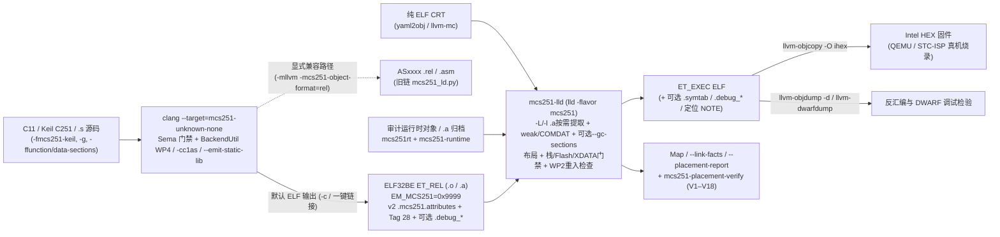

# MCS-251 LLVM 工具链系统技术文档

> **源码核对基线**：`minimal-isr` 分支基线 `cad7f0ab1f32` + 工作区 Track 1/Track 2（`.a` 静态库、`weak`/COMDAT、`--gc-sections`、`MCS251Disassembler`、`MCS251AsmParser`/内联汇编、ELF DWARF `-g`）+ **Route B 栈传参可重入默认 ABI**（结构体/联合体 `byval`/`sret`、无上限栈变参、`__reentrant`/Keil `reentrant`、`CSR_MCS251={DR12,WR8}` 与直接尾调用 `ejmp`）+ **默认 ELF 输出与 Clang Driver 一键汇编/归档/链接、C11 `_Atomic`/`__atomic_*`/`__sync_*` 与 `fence`（`EA` 临界区）、`mcs251-runtime` 栈变参与 `_memmove`/原子库** + **`mcs251-lld` 完整工程化能力**（`@response-file`、`--map-json`、GNU 链接脚本 `-T`、Full/Thin LTO 集成、G11 审计支持 `.a` 与 `--gc-sections`、硬件 ISR 优先级属性/SFR 自动初始化与抢占图自动推导、`llvm-readobj` 完整解码与 LLDB 目标架构/ABI 源码接入）  
> **目标架构与芯片**：Intel / STC MCS-251（典型目标 MCU：`STC32G12K128`、`STC32G144K246`）  
> **文档定位**：本目录以**当前工作树实际源码实现**为唯一事实真源，将原分散于全仓库的 108 份规范、设计提案、验收报告与工程 README 整合为一套结构化手册；其中 48 份已替代/严重滞后提案与旧链归档已清理，其余 60 份实测证据、活跃目录 README 与用例记录保留并已同步修正过时段落。

---

## 文档导航

| 文档 | 主题与涵盖内容 | 对应核心源码路径 |
|---|---|---|
| [01-architecture-and-abi.md](./01-architecture-and-abi.md) | 架构模型、大端与 `m:s` 符号修饰、5 元组内存契约、AS0–AS9 地址空间实测表、寄存器与调用约定、静态参数槽、REL/ELF 对象格式、v1/v2 对象身份、Tag 28 函数签名与 ISR/Bit 二进制线格式 | `llvm/lib/TargetParser/MCS251TargetParser.*`、`llvm/include/llvm/BinaryFormat/MCS251*`、`MCS251RegisterInfo.td`、`MCS251CallingConv.td` |
| [02-clang-frontend-and-dialect.md](./02-clang-frontend-and-dialect.md) | Clang Driver 与编译器选项、ILP32/`+int16` 与 `binary32`、`MCS251Bit` 与 `va_list`、`-fmcs251-keil` 关键词与语法扩展、8 个目标属性（含 G11 固定放置）、目标内建（含 9 个 TFPU 内建）、WP4 Fail-Closed 语义与 ThinLTO 门禁 | `clang/lib/Driver/ToolChains/MCS251.*`、`clang/lib/Basic/Targets/MCS251.*`、`clang/lib/Parse/`、`clang/lib/Sema/SemaMCS251.*`、`clang/lib/CodeGen/Targets/MCS251.cpp`、`CGMCS251Bit.cpp` |
| [03-llvm-backend-codegen.md](./03-llvm-backend-codegen.md) | 后端 Pass 流水线（`ContractCheck` / `LoweringPrep` / `LocalInterp` / `TFPUExpand` / `BranchRelaxation`）、除余与软浮点 libcall、TFPU 4 伪指令与 NOP 链、`SEXTLOAD` / 移位 / 跳转表、位指令与 `.rodata` 分流、AS3 `MOVX` 自愈 DPXL / AS4 统一通道、ISR 37B 帧与全局初始化（XINIT/XDATA_INIT/G8/G11/G13b） | `llvm/lib/Target/MCS251/*`、`llvm/include/llvm/IR/IntrinsicsMCS251.td` |
| [04-lld-linker-and-safety.md](./04-lld-linker-and-safety.md) | 专用链接器 `mcs251-lld` 架构与完整 CLI 参数、16 步链接管线、v1/v2 身份与 Tag 28 跨 TU 校验、哈佛多空间布局（127 槽 VECS、G8 自动 EDATA 迁移、G13b 大全零 XSEG 拆分、BT14 位初始化）、栈/Flash/XDATA 门禁、WP2 地址级静态参数槽重入检测与 `--link-facts`、G11 报告与独立验证器 `mcs251-placement-verify`、`llvm-readobj` 扩展 | `lld/MCS251/*`、`llvm/tools/llvm-readobj/ELFDumper.cpp` |
| [05-runtime-porting-and-validation.md](./05-runtime-porting-and-validation.md) | `mcs251rt` 整数除余运行时、`validation/mcs251-runtime` 软浮点/位工具/libc/printf 运行时及 IR 审计门禁、纯 ELF CRT 套件（v1/v2/IRQ/BT14）、Keil 官方例程移植工具（`sfr-convert.py` / `uvproj2make.py` / `<intrins.h>`）、430 个内置测试与「静态 / QEMU / 真机」严格分级证据矩阵 | `llvm/lib/Target/MCS251/Runtime/`、`validation/mcs251-runtime/`、`validation/mcs251-elf/runtime/`、`validation/mcs251-porting/`、`validation/mcs251-*` |
| [06-doc-inventory-and-code-audit.md](./06-doc-inventory-and-code-audit.md) | 保留的 60 份文档分类总索引、已清理的 48 份滞后提案与归档清单、高影响度「原文档 vs HEAD 代码」差异记录，以及现行源码中的已知小缺陷与过时注释审计 | `lld/MCS251/BIT-OBJECT-CONTRACT.md`、`llvm/lib/Target/MCS251/Runtime/README.md`、`validation/**` |

---

## 端到端工具链全景



---

## 当前能力全景与红线边界

| 能力域 | 现行状态 | 关键约束与说明 |
|---|---|---|
| **基础 C11 与数据模型** | **已实现** | 默认大端、1B 对齐、ILP32；支持 `+int16`；`float`/`double`/`long double` 均为 32 位 IEEE binary32；`_BitInt(N)` 支持至 `N <= 32`；WP5 支持 `_Bool` 参数与 `binary32` 全局存储 |
| **内存模型与地址空间** | **部分实现** | 5 元组契约支持 `tiny`/`xtiny`/`small`/`xsmall`(默认)/`large` 与 v1 `1,1,32,8,1`；**ELF v2 对象发射仅放行 `small (32,1)` 与 `xsmall (32,8)`**；16 位指针（`tiny`/`xtiny`）仅可输出汇编、禁止发 `.o`；AS3(`__xdata`)/AS4(`__code`)/AS6(SFR `0x80..0xFE`) 可用；AS5/AS7 禁用；AS1/AS2/AS8/AS9 全局定义未开放 |
| **Keil C251 方言** | **已实现核心子集** | C 模式原生支持 `__bit`/`__xdata`/`__code`/`__reentrant`；`-fmcs251-keil` 启用裸 `bit`/`sbit`/`xdata`/`code`/`interrupt N`/`reentrant`；`_at_`/`__idata`/`__pdata`/`__near`/`__far`/`__banked`/`using` 均在解析层显式报错拒收 |
| **栈传参可重入 ABI、聚合、CSR 与尾调用（Route B）** | **已实现（默认 ABI）** | 第 1 标量参仍走 `DPL`/`DPTR`/`DPL:DPH:B:A`，第 2+ 参及 `byval` 统一压栈（先 `inc spx` 后写槽保中断安全，彻底消除静态 `_fn_PARM_n`/`OSEG` 槽）；支持结构体/联合体按值传参（`byval` align 1：`<=16B` 展开，`>16B` 内联字节循环/`_memcpy`）与按值返回（1/2/4B 寄存器打包，3B/`>4B`/非平凡 `sret`）；全面放开多参数间接调用（含 `__bit`）、多参数递归与 ISR/前台共用多参函数重入；启用 `CSR_MCS251 = {DR12, WR8}` 与直接尾调用 `TCRETURNdi`（`ejmp`） |
| **中断（ISR）与硬件优先级** | **已实现（G1 127 槽 + 优先级自动推导）** | `__attribute__((interrupt(N)))` / `interrupt N` 覆盖 G144K246 127 槽（`0..126`：109 合法/16 保留/2 系统），固定 37B 保存帧 + `RETI`；支持 `__attribute__((mcs251_isr_priority(P)))` / `[[mcu::isr_priority(P)]]`（`P ∈ [0..3]`）与 `--isr-priority=<sym\|slot>=<0..3>`，`lld` 自动按 `pri(B) > pri(A)` 推导嵌套抢占对喂给 WP2 重入检测并合成可调用的 STC32G 优先级 SFR 初始化例程 `__mcs251_isr_priority_init`（写入 `IP`/`IPH`/`IP2`/`IP2H`/`IP3`/`IP3H`） |
| **位类型与位寻址（bit/sbit）** | **已实现（含 BT14）** | 一等 `MCS251Bit` 类型、固定 `sbit`/`__builtin_mcs251_bit_lvalue`、持久化符号位对象（`.mcs251.bit` + `R_MCS251_BITADDR8`）、BT14 邻位保护 RMW 初始化表（`BITINIT`）、位模块 `.rodata` 分流 |
| **固定地址放置（G11）** | **已实现（全链闭合，支持 `.a` 与 `--gc-sections`）** | `mcu_place_at`/`mcu_bind_at`/`mcu_retain`/`noinit`（支持 GNU/C++11/C23 拼写，`noinit` 仅 GNU），`.mcu.fixed.*` + 双 NOTE + `lld` `FIXED` 区域 + 定位 NOTE + 独立进程校验器 `mcs251-placement-verify`（V1–V18），审计模式已支持 `.a` 静态库按偏移独立校验与 `--gc-sections` 联用 |
| **变参 ABI（栈游标）** | **已实现（无上限）** | `{ptr __base, i32 __off}` `va_list`（32 位 AS0 为 8B，16 位 AS0 为 6B），`va_arg` 向下步进读取栈区；解除 6 参硬上限、放开间接变参调用、C23 零固定参（`void f(...)`）、结构体/联合体变参与 `va_arg(ap, __bit)`；仅拒收 `>32` 位整数与非普通空间指针变参 |
| **算术、软浮点、原子库与 TFPU** | **已实现** | 8 个整数除/余 helper（`mcs251rt`）；16 个 `f32` 软浮点 helper（含无符号转换、硬件 `MULW` 乘法重写、分模块拆包）；3 个聚合内存 helper（`_memcpy`/`_memmove`/`_memset`）；5 个大对象原子 helper（`___atomic_{load,store,exchange,compare_exchange,is_lock_free}`）；9 个 STC32G TFPU 硬件协处理器内建（`i32` 位模式 + 最坏 NOP 等待链） |
| **C11 `_Atomic` / `__atomic_*` / `__sync_*` 与 `fence`** | **已实现** | 移除 `__STDC_NO_ATOMICS__`；1/2/4B 原子读写/RMW/CAS（任意 1B 对齐、全地址空间）通过硬件全局中断位 `EA`（`IE.7`, 位 `0xAF`）临界区内联展开（`jbc 0xAF` 原子测试清零 + 条件 `setb 0xAF` 恢复，可嵌套且对 ISR 安全）；`fence` 降为零字节编译屏障；`>4B` 结构体原子路由至 `mcs251_atomic.c` 通用 libcall（绝不合成 `i64`）；同时提供 `__builtin_mcs251_ea_save_disable`/`restore` |
| **跳转表、G8 与 G13b** | **已实现** | `-mcs251-jump-tables`（默认关闭，跨度 `<= 86`，ELF 专用）；G8 自动 DSEG→EDATA 溢出迁移（`SHF_MCS251_EDATA_MOVABLE`）；G13b `>65535B` 全零 XDATA 拆分与清零表合成（`SHF_MCS251_XSEG_SPLIT`） |
| **默认 ELF、Clang 一键构建、LTO、链接脚本、静态库、Weak/COMDAT 与 GC** | **已实现（默认 ELF 链）** | `-mcs251-object-format` **默认切为 `elf`**（旧 `.rel` 须显式传 `-mcs251-object-format=rel`）；`clang --target=mcs251-unknown-none` 打通一键汇编、一键归档（`--emit-static-lib`）、一键链接与 `-T`/`-flto`/`-flto=thin` 透传；`mcs251-lld` 支持 `@response-file`、`--map-json`、GNU 链接脚本（`-T`/`--script`）、Full/Thin LTO（含 bitcode 归档与链接期 MCS-251 契约/Tag 28 校验）、`-L`/`-l`/`-l:`/`-s`、`.a` 按需提取、`STB_WEAK`/`GRP_COMDAT` 与 `--gc-sections` |
| **MC 汇编/反汇编与内联汇编** | **已实现（ELF 链）** | 完整 `MCS251Disassembler`（`llvm-mc --disassemble`、`llvm-objdump -d`）与 `MCS251AsmParser`（`llvm-mc -filetype=obj`、`clang -c .s` 集成汇编器）；默认 ELF 模式下支持模块级 `asm(...)` 与函数内联汇编（含寄存器约束） |
| **DWARF `-g` 与调试工具链** | **已实现（ELF 链；LLDB 源码已接入）** | 默认 ELF 模式下直接支持 `-g` 生成 `.debug_*` 与 `R_MCS251_32`，`mcs251-lld` 完成多 TU 拼接、重定位与非 ALLOC 发射（不入 `PT_LOAD`，与 `-g0` 产出逐字节一致的 Intel HEX），支持 `llvm-dwarfdump --verify`；`llvm-readobj` 完整解码 v2 `e_flags`、`SHT_MCS251_ATTRIBUTES`、type 1/2/3 NOTE 与 Tag 28 签名表；LLDB 源码树已接入 `eCore_mcs251`、`EM_MCS251` 与 `ABISysV_mcs251` 插件（需启用 `-DLLVM_ENABLE_PROJECTS="clang;lld;lldb"` 构建） |
| **链接器静态安全门禁** | **已实现** | 栈容量门禁（`>= 1024B`，不可关闭）、Flash/XDATA 窗口门禁、WP2 地址级静态参数槽重入检测（默认 `error`；新栈 ABI 下编译函数零槽冲突）、P-4 Tag 28 跨 TU 函数签名两两校验、事务性原子输出发布 |
| **明确不支持 / Fail-Closed 项** | **显式拒收** | `i64` 运行期算术（常量折叠/死代码除外）、真 `f64`（无条件拒收）、向 `__code` 的写/原子写操作、REL 模式 `-g` 与内联汇编、ISR/Bit/G11/REL 的弱定义与 COMDAT、computed goto、静态绝对地址指针初值、OpenMP/OpenACC 中使用 bit、动态链接/TLS/VLA/异常 |

---

## 快速上手（典型构建与编译命令）

### 1. 构建编译器、链接器与运行时

```bash
# 阶段 1：配置并构建 clang、llc、lld (mcs251-lld)、mcs251-placement-verify 与 MC/调试/归档工具
cmake -G Ninja -S llvm -B build \
  -DLLVM_ENABLE_PROJECTS="clang;lld" \
  -DLLVM_TARGETS_TO_BUILD="MCS251" \
  -DLLVM_MCS251_ENABLE_RUNTIME=ON
ninja -C build clang llc lld mcs251-placement-verify \
  llvm-mc llvm-objdump llvm-dwarfdump llvm-ar llvm-objcopy llvm-readobj yaml2obj

# 阶段 2a：构建 8 个整数除/余 ELF 对象与清单（显式 target，不在 ALL 中）
ninja -C build mcs251rt

# 阶段 2b：构建软浮点 / bitutil / libc / printf 运行时（独立 CMake 工程）
cmake -G Ninja -S validation/mcs251-runtime -B build-rt \
  -DMCS251RT_CLANG=$PWD/build/bin/clang \
  -DMCS251RT_LLC=$PWD/build/bin/llc
ninja -C build-rt
```

### 2. 编译单个 C/汇编源码或生成静态库（默认 v2 ELF）

> **默认格式与内置设备头**：`llc -filetype=obj` 与 `clang` 现**默认输出 v2 ELF32BE 对象（`-mcs251-object-format=elf`）**，不再需要手工附加 `-mllvm -mcs251-object-format=elf`；仅当需要兼容旧 ASxxxx `.rel` 链时才显式传 `-mllvm -mcs251-object-format=rel`。Clang 资源头目录已内置开箱即用的 STC32 头文件套件（`<stc32.h>`、`<stc32_gpio.h>`、`<stc32g.h>`、`<stc32g144k246.h>`、`<mcs251_intrins.h>`），默认使用 AS6 直寻址 SFR、32 位 XFR、硬件位操作与 G1 合法中断向量表，无需额外 `-I` 参数。

```bash
# 直接编译单个 C 源码为 v2 ELF 对象（支持 -g 调试信息与 C11 原子）
clang --target=mcs251-unknown-none -std=c11 -O2 -g -fmcs251-keil -c main.c -o main.o

# 编译汇编文件或直接打包静态库（调用 llvm-ar）
clang --target=mcs251-unknown-none -c startup.s -o startup.o
clang --target=mcs251-unknown-none --emit-static-lib util.c -o libutil.a
```

### 3. 一键编译链接与生成 Intel HEX

```bash
# 方式 A：通过 clang 一键编译 + 自动调用 mcs251-lld（支持 -L / -l）
clang --target=mcs251-unknown-none -std=c11 -O2 -g -fmcs251-keil \
  crt-irq-v2.o main.c -Lbuild-rt -lmcs251runtime -lmcs251rt \
  -Wl,--area-start=HOME=0xff0000 \
  -Wl,--area-start=VECS=0xff0003 \
  -Wl,--area-start=BOOT=0xff0500 \
  -Wl,--area-start=CSEG=0xff0700 \
  -Wl,--area-start=XINIT=0xfe0000 \
  -Wl,--area-start=XDATA_INIT=0xfe0280 \
  -Wl,--area-start=XSEG=0x010000 \
  -Wl,--edata-end=0x3fff \
  -Wl,--xdata-size=0x20000 \
  -Wl,--flash-base=0xfc2800 -Wl,--flash-size=0x3d800 \
  -Wl,--map=firmware.map \
  -o firmware.elf

# 方式 B：分步显式调用 lld -flavor mcs251（参数与上相同，支持 -L / -l / -s）
llvm-objcopy -O ihex firmware.elf firmware.hex
```

> 更多细节（如 `g13a-fe640` 配方保护规则、STC32G12K128 `EDATA_END=0x0fff` 边界、G11 审计与 `--verify-placement`）请参阅 [04-lld-linker-and-safety.md](./04-lld-linker-and-safety.md) 与 [05-runtime-porting-and-validation.md](./05-runtime-porting-and-validation.md)。
